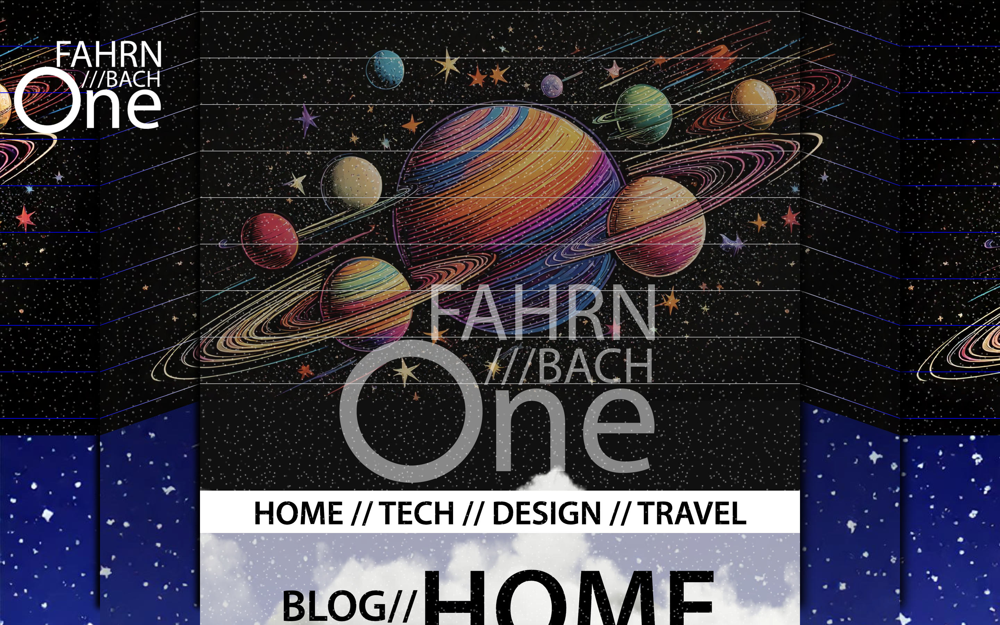

# 🚀 BLOG - So it is Written

**Live Site:** [blog.fahrnbach.one](https://blog.fahrnbach.one)  
**Repo:** [github.com/fahrnbach/blog-monorepo](https://github.com/fahrnbach/blog-monorepo)



## 📁 Folder Structure

```
blog-app/
├── backend/                  # Python CMS API
│   ├── app/                  # Your Python code (e.g. Flask/FastAPI modules)
│   ├── requirements.txt      # Python dependencies
│   └── README.md             # Backend-specific setup
│
├── frontend/                 # Angular frontend
│   ├── src/                  # Angular source code
│   ├── angular.json
│   └── README.md             # Frontend-specific setup
│
├── .gitignore
└── README.md                 # Root project documentation
```

---

## 📄 Root `README.md`

# Blog CMS with Angular Frontend and Python Backend

This is a full-stack blog project built with a **Python backend CMS API** and an **Angular frontend**. Posts are stored as Markdown files and served via a headless API to a dynamic front-end site.

---

## 🧱 Project Structure

```
blog-app/
├── backend/       → Python API (e.g., FastAPI/Flask)
├── frontend/      → Angular frontend
```

---

---

---\----------------------------------------------------------\---

## 🚀 Getting Started

### 1. Clone the Repository

```bash
git clone https://github.com/your-username/blog-app.git
cd blog-app
```

---

### 2. Run the Backend (Python)

```bash
cd backend
python3 -m venv venv
source venv/bin/activate      # Use `venv\Scripts\activate` on Windows
pip install -r requirements.txt
python main.py
```

This starts the CMS API at `http://localhost:8000` (or your configured port).

---

### 3. Run the Frontend (Angular)

```bash
cd frontend
npm install
ng serve
```

The Angular app runs at `http://localhost:4200` and pulls blog data from the backend API.

---

## 📦 Tech Stack

- **Frontend**: Angular 16+
- **Backend**: Python (FastAPI or Flask)
- **Blog Content**: Markdown files
- **API Format**: JSON

---

## 📚 Future Plans

- Authentication for blog editing
- CMS admin interface
- Deployment to AWS or Render
- Styling improvements and animations

---

# Portfolio Links:

> [📖 Live Demo (Blog)](https://blog.fahrnbach.one)
>
> [🌐 Portfolio Site](https://fahrnbach.one)
>
> [🗃️ Angular Component Library](https://library.fahrnbach.one)
>
> [🎨 Art App](https://art.fahrnbach.one)

## 📬 Let’s Connect

- 🌐 Portfolio: [fahrnbach.one](https://fahrnbach.one)
- 💼 LinkedIn: *https://www.linkedin.com/in/fahrnbach*
- 📧 Email: *jacob@fahrnbach.one*

---

> _“Code is craft. Design is empathy. My goal is to bridge the two.”_
